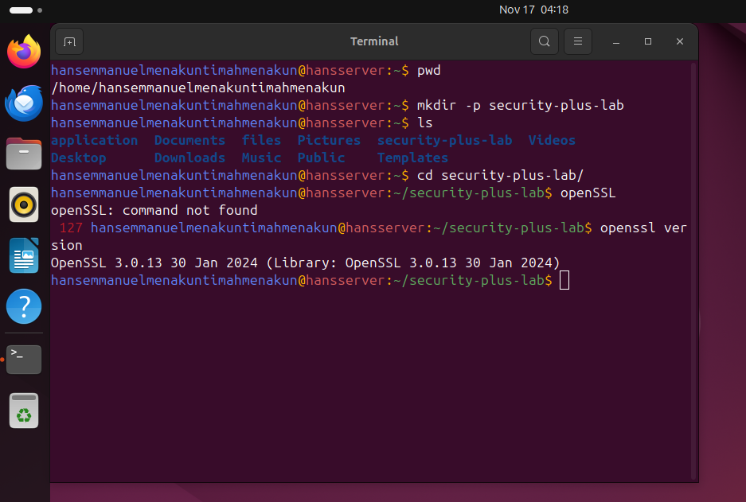
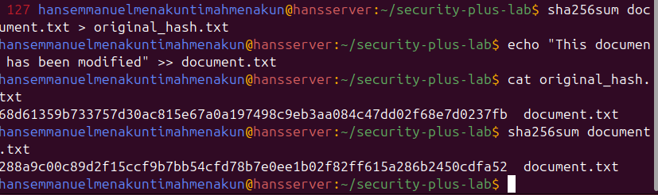
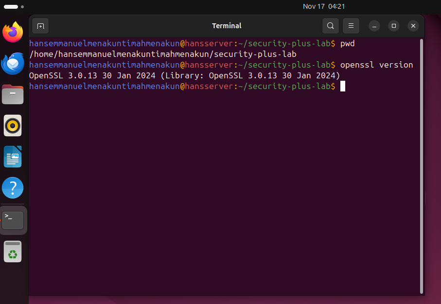
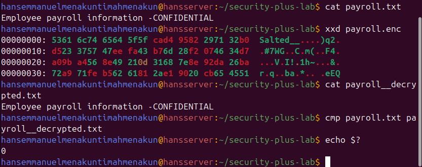
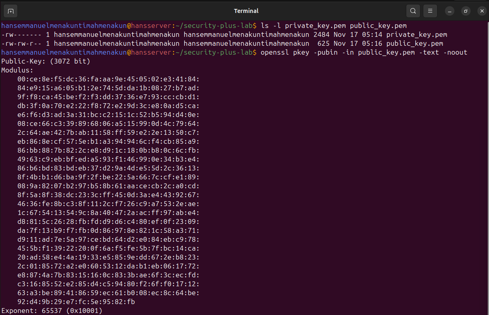
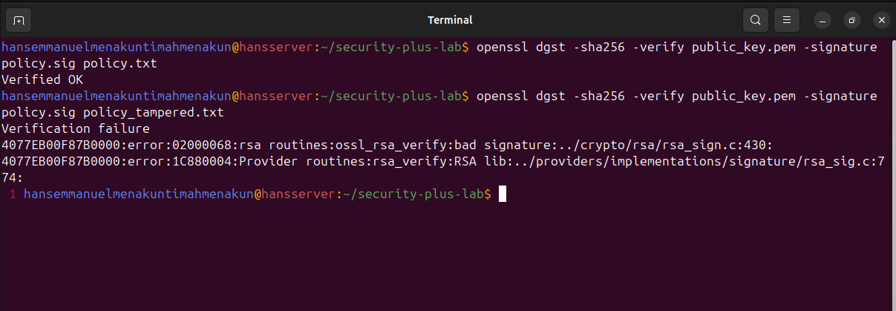
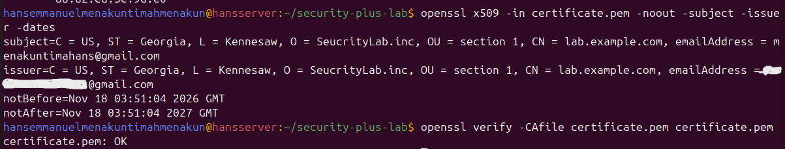

# Security+ Cryptography & PKI Lab

## Project Overview

This hands-on lab was created to strengthen my understanding of cryptography and Public Key Infrastructure (PKI) while studying for the CompTIA Security+ SY0-701 certification.

Using Ubuntu Linux and OpenSSL, I practiced hashing, symmetric encryption, asymmetric cryptography, digital signatures, and digital certificate management.

The goal of this project was to understand how cryptographic technologies protect data confidentiality, integrity, and authenticity through practical exercises.

## Tools and Technologies

- Ubuntu Linux
- OpenSSL
- SHA-256
- AES-256-CBC
- RSA-3072
- X.509 Digital Certificates
- Git and GitHub 

## Hands-On Lab Exercises

### 1. Hashing and Data Integrity (SHA-256)

- Created a text file and generated its SHA-256 hash.
- Modified the original file and observed that its hash changed.
- Used `sha256sum -c` to detect unauthorized modifications.

**What I learned:** Hashing helps verify data integrity by detecting changes to files.

### 2. Symmetric Encryption (AES-256)

- Created a fictional payroll file containing confidential information.
- Encrypted the file using AES-256-CBC with OpenSSL.
- Used PBKDF2 for password-based key derivation.
- Decrypted the file and verified that it matched the original.

**What I learned:** Symmetric encryption protects confidentiality by using the same secret key for encryption and decryption.

### 3. Asymmetric Cryptography (RSA)

- Generated a 3072-bit RSA private key.
- Extracted the corresponding public key.
- Restricted private key permissions using `chmod 600`.
- Inspected the public key using OpenSSL.

**What I learned:** Asymmetric cryptography uses a public/private key pair for operations such as digital signatures and secure key establishment.

### 4. Digital Signatures

- Created a fictional security policy.
- Digitally signed the policy using my RSA private key and SHA-256.
- Verified the signature using the public key.
- Modified the policy and observed that signature verification failed.

**What I learned:** Digital signatures help verify authenticity and integrity and support non-repudiation.

### 5. Public Key Infrastructure (PKI)

- Generated a self-signed X.509 certificate.
- Inspected the certificate's subject, issuer, and validity dates.
- Verified the certificate using an explicitly trusted certificate file.
- Checked whether the certificate had expired.

**What I learned:** PKI uses certificates, public keys, and trust relationships to support secure authentication and communication.

## Lab Screenshots

### 1. OpenSSL Setup

### 2. SHA-256 Hashing and Integrity

### 3. AES-256 Encryption and Decryption

### 4. RSA Public and Private Keys

### 5. Digital Signatures and Tampering Detection

### 6. PKI and X.509 Digital Certificates

## Security Considerations

Throughout this lab, I followed security practices including:

- Restricting RSA private key permissions using `chmod 600`.
- Keeping private keys out of public Git repositories.
- Using PBKDF2 for password-based encryption.
- Verifying file integrity and digital signatures.
- Understanding that self-signed certificates are not automatically trusted.
- Checking certificate expiration and validity information.

**Limitations:** AES-256-CBC provides confidentiality but does not independently authenticate encrypted data. In production environments, authenticated encryption such as AES-GCM is generally preferred.

## Key Takeaways

This lab helped me better understand how cryptography is applied in real-world cybersecurity environments. I gained hands-on experience with OpenSSL and Linux while practicing concepts covered in CompTIA Security+ SY0-701.

I also learned the importance of protecting private keys, verifying data integrity, and understanding certificate trust.

## Future Improvements

- Practice certificate signing requests (CSRs) and CA-issued certificates.
- Explore certificate revocation using CRLs and OCSP.
- Practice authenticated encryption using AES-GCM.
- Apply cryptographic security concepts to AWS services.
